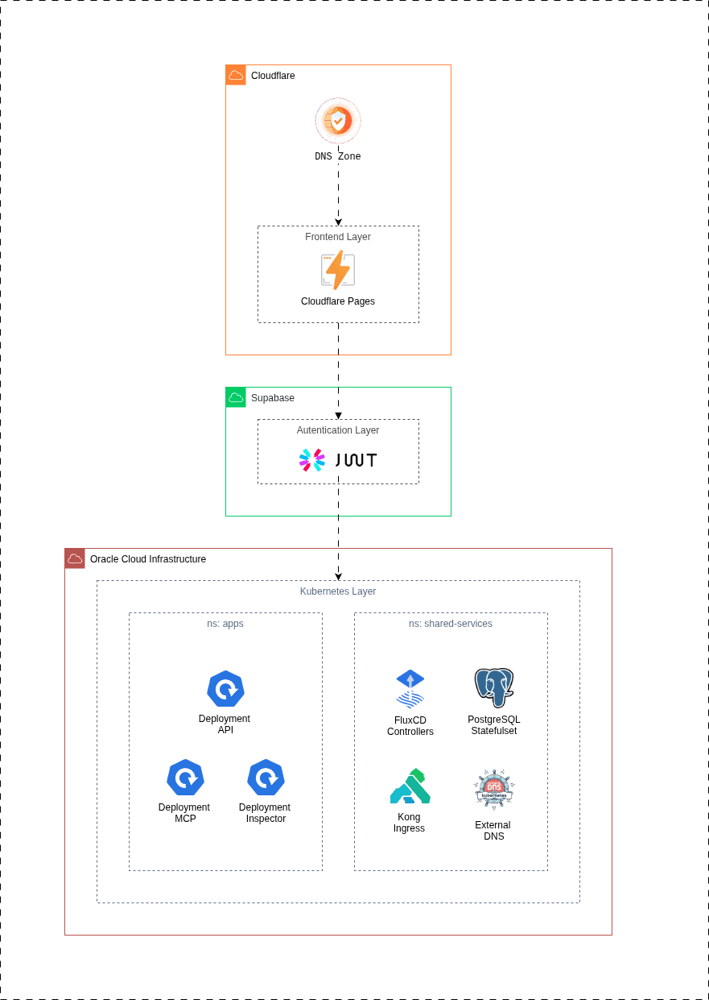

<h1 align="center">
  ost-iac.terraform
</h1>

<p align="center">
  
</p>

<p align="center">
  <a href="https://skillicons.dev">
    
  </a>
</p>

## Qual a finalidade do projeto?

Infraestrutura como código para o cluster Kubernetes (**OKE**) da oneshift na
**Oracle Cloud Infrastructure (OCI)**, com DNS gerenciado na **Cloudflare** e
GitOps via **FluxCD**. Todo o provisionamento é feito por Terraform e
versionado neste repositório — do cluster ao bootstrap dos serviços internos.

A proposta é manter o cluster inteiramente descartável: `terraform apply`
recria o OKE, os serviços compartilhados (ingress, DNS, Postgres) e a
integração com o Flux do zero, sem passos manuais além dos pré-requisitos de
bootstrap (compartment, chave SOPS e token Cloudflare). Os secrets sensíveis
do cluster (`sops-age`, `flux-git-auth`) também são criados pelo próprio
Terraform a cada apply.

Design completo: `docs/superpowers/specs/2026-07-14-oke-oci-iac-design.md`.

## O que foi construído

### Infraestrutura (Terraform)

| Arquivo | Descrição |
|---|---|
| `01-oke.tf` | Cluster OKE (`oke-oneshift-prd`) via módulo oficial `oracle-terraform-modules/oke/oci`, node pool `np-oneshift-prd` |
| `02-cloudflare-token.tf` | Token de API escopado a DNS, criado pro external-dns |
| `03-fluxcd.tf` | Bootstrap do FluxCD no cluster |
| `04-cluster-secrets.tf` | Secrets `sops-age` e `flux-git-auth` criados no cluster via provider `kubernetes` |

### GitOps (FluxCD)

| Diretório | Descrição |
|---|---|
| `fluxcd/shared-services/` | ingress-nginx, external-dns, Postgres interno (bitnami), inspector — cada um com um `values-fluxcd.yaml` multi-doc |
| `fluxcd/apps/` | Apps da oneshift reconciliadas pelo Flux: `api` e `mcp` |

### Pipelines (GitHub Actions)

| Workflow | Gatilho | Descrição |
|---|---|---|
| `infra-apply.yml` | push na `main` tocando `terraform/**` | plan + apply automático; re-criptografa o secret do token Cloudflare se ele mudou |
| `infra-destroy.yml` | manual (`workflow_dispatch`) | exige digitar `oneshift`; limpa Ingress/Service antes do destroy pra dar tempo do external-dns/LB desprovisionarem |

## Tecnologias utilizadas

- **OCI (Oracle Cloud Infrastructure):** hospeda o cluster **OKE** e o Object Storage do state remoto;
- **Terraform:** provisionamento de toda a infraestrutura como código;
- **Kubernetes (OKE):** cluster gerenciado onde rodam os serviços compartilhados e as apps;
- **FluxCD:** sincronização GitOps dos manifests em `fluxcd/`;
- **Cloudflare:** DNS da zona `oneshift.com.br`, gerenciado via external-dns;
- **SOPS + age:** criptografia dos secrets versionados no Git;
- **PostgreSQL (bitnami):** banco interno do cluster, usado pela API via `DATABASE_URL`;
- **GitHub Actions:** pipelines de apply e destroy da infra.

## Estrutura do repositório

```text
ost-iac.terraform/
├── terraform/                   # Cluster OKE, token Cloudflare, bootstrap FluxCD, secrets do cluster
├── fluxcd/                      # Manifests reconciliados pelo Flux
│   ├── shared-services/         # ingress-nginx, external-dns, postgres, inspector, flux-system
│   └── apps/                    # api, mcp
├── .github/workflows/           # infra-apply.yml, infra-destroy.yml
├── docs/                        # Specs, plans e diagrama de arquitetura
├── backend.hcl.example          # Template do backend remoto (state)
├── backend.md                   # Bootstrap manual do compartment + bucket de state
└── .sops.yaml                   # Chave pública age usada pelo SOPS
```

## Fluxo de funcionamento

1. Bootstrap manual, uma vez só: compartment + bucket de state, chave age,
   token Cloudflare e PAT do Flux (ver seção abaixo).
2. Push na `main` alterando `terraform/**` dispara o `infra-apply.yml`.
3. Terraform provisiona o cluster OKE e o node pool.
4. Terraform cria os secrets `sops-age` e `flux-git-auth` no cluster.
5. Terraform faz o bootstrap do FluxCD, apontando pro path `./fluxcd` deste
   repositório.
6. FluxCD clona o repositório (autenticado via `flux-git-auth`) e decripta os
   manifests com SOPS/age.
7. FluxCD reconcilia `shared-services` (ingress-nginx, external-dns,
   Postgres, inspector) e `apps` (api, mcp).
8. `external-dns` sincroniza os registros DNS na Cloudflare pros hosts
   expostos pelo ingress-nginx.

## Como validar a entrega

- `terraform plan` sem diffs logo após um apply limpo;
- pods dos namespaces `shared-services` e `apps` em `Running`;
- `kubectl get ingress` mostrando os hosts `api.`, `mcp.`, `inspector.` e
  `inspector-proxy.oneshift.com.br`;
- registros DNS criados na Cloudflare pelo external-dns (proxied);
- `flux get kustomizations` com tudo `Ready`;
- secrets `sops-age` e `flux-git-auth` presentes no cluster.

## Bootstrap manual (uma vez só)

Estes passos não são automatizados de propósito — são problemas reais de
ovo-e-galinha (a infra que os gerenciaria ainda não existe).

### 1. Compartment + bucket de state

Ver `backend.md` pro passo a passo completo (comandos `oci` CLI pro
compartment `oneshift` e o bucket `oneshift-tfstate-prd`, Customer Secret
Key e como ligar tudo em `backend.hcl`/GitHub Secrets).

### 2. Chave age para o SOPS

Já gerada em `age.key` (local, gitignored) durante a implementação inicial —
guarde o conteúdo em um gerenciador de senhas. A chave pública vai em
`.sops.yaml` (na raiz do repo, inalterado). O conteúdo da chave **privada**
vai no secret `SOPS_AGE_PRIVATE_KEY` do GitHub — o Terraform cria o secret
`sops-age` no cluster automaticamente em todo `apply` (via provider
`kubernetes`, ver `04-cluster-secrets.tf`), não precisa mais de
`kubectl create secret` manual.

Se perder `age.key`, gere um novo par com `age-keygen -o age.key`, atualize
a chave pública em `.sops.yaml`, re-criptografe os secrets existentes em
`fluxcd/` e atualize o valor do secret `SOPS_AGE_PRIVATE_KEY` no GitHub.

### 3. Token de API de conta da Cloudflare

Criado manualmente no dashboard da Cloudflare (Profile → API Tokens),
permissão de usuário **"API Tokens" → Edit** (não é a "Account API Tokens" —
essa é escopada à conta e não autoriza consultar `permission_groups_list`
nem criar tokens via API, dá 403; a de usuário é a exigida pelo provider
pros recursos `cloudflare_api_token`/`cloudflare_api_token_permission_groups_list`).
É o token usado pelo Terraform pra criar o token específico do external-dns,
escopado só a DNS. Guarde o valor no secret `CLOUDFLARE_ACCOUNT_API_TOKEN` do
GitHub.

### 4. Credencial de git para o Flux (repositório privado)

O repositório `Oneshift-Organization/ost-iac.terraform` é **privado**, então o
`GitRepository` do Flux precisa de credenciais pra clonar. Gere um GitHub
Personal Access Token (fine-grained, permissão de leitura em "Contents" só
pra este repositório; um PAT clássico com escopo `repo` também funciona se o
fine-grained não estiver disponível). O usuário e o token vão nos secrets
`FLUX_GIT_USERNAME`/`FLUX_GIT_TOKEN` do GitHub — o Terraform cria o secret
`flux-git-auth` no cluster automaticamente em todo `apply`, mesmo mecanismo
do `sops-age` acima. Isso importa porque o cluster é destruído e recriado
repetidamente pelos pipelines, não só uma vez — um passo manual por cluster
não seria sustentável.

## GitHub Secrets necessários

| Secret | Descrição |
|---|---|
| `OCI_TENANCY_OCID` | OCID da tenancy |
| `OCI_USER_OCID` | OCID do usuário de API key |
| `OCI_FINGERPRINT` | Fingerprint da chave de API |
| `OCI_PRIVATE_KEY` | Conteúdo da chave privada PEM |
| `OCI_REGION` | Região da OCI (ex: `us-ashburn-1`) |
| `OCI_HOME_REGION` | Home region da tenancy |
| `CLOUDFLARE_ACCOUNT_API_TOKEN` | Token de conta Cloudflare (bootstrap manual acima) |
| `CLOUDFLARE_ZONE_ID` | Zone ID do domínio da oneshift |
| `TF_STATE_BUCKET` | Nome do bucket de state |
| `TF_STATE_S3_ENDPOINT` | Endpoint S3-compatible do Object Storage |
| `TF_STATE_ACCESS_KEY` | Customer Secret Key — access key |
| `TF_STATE_SECRET_KEY` | Customer Secret Key — secret key |
| `OCI_COMPARTMENT_ID` | OCID do compartment `oneshift` (ver `backend.md`) |
| `SOPS_AGE_PRIVATE_KEY` | Conteúdo da chave privada age (bootstrap manual acima) |
| `FLUX_GIT_USERNAME` | Usuário pro git auth do Flux (ex: `git`) |
| `FLUX_GIT_TOKEN` | PAT do GitHub pro Flux clonar o repo privado |

## Rodando localmente

```bash
cd terraform
cp terraform.tfvars.example terraform.tfvars   # preencha com valores reais
terraform init -backend-config=../backend.hcl
terraform plan
```

`terraform.tfvars.example` cresceu com os últimos ajustes (compartment e os
dois secrets declarativos) — mesma mecânica, só mais variáveis pra
preencher.

## Pipelines

- **`infra-apply.yml`** — push na `main` que toque `terraform/**` dispara
  plan + apply automático, e re-criptografa
  `fluxcd/shared-services/external-dns/secret.sops.yaml` se o token da
  Cloudflare mudou. Autentica a OCI CLI via variáveis de ambiente nativas
  (`OCI_CLI_USER`, `OCI_CLI_TENANCY` etc.), sem escrever `~/.oci/config`.
- **`infra-destroy.yml`** — manual (`workflow_dispatch`), exige digitar
  `oneshift` para confirmar. Limpa os Ingress e o Service do ingress-nginx
  do cluster antes do destroy (dá tempo do external-dns remover os
  registros DNS e da OCI desprovisionar o Load Balancer associado ao
  Service, que não é gerenciado pelo Terraform). Usa a action oficial
  `oracle-actions/configure-kubectl-oke` pra configurar o `kubectl`, em vez
  de rodar `oci ce cluster create-kubeconfig` manualmente.
