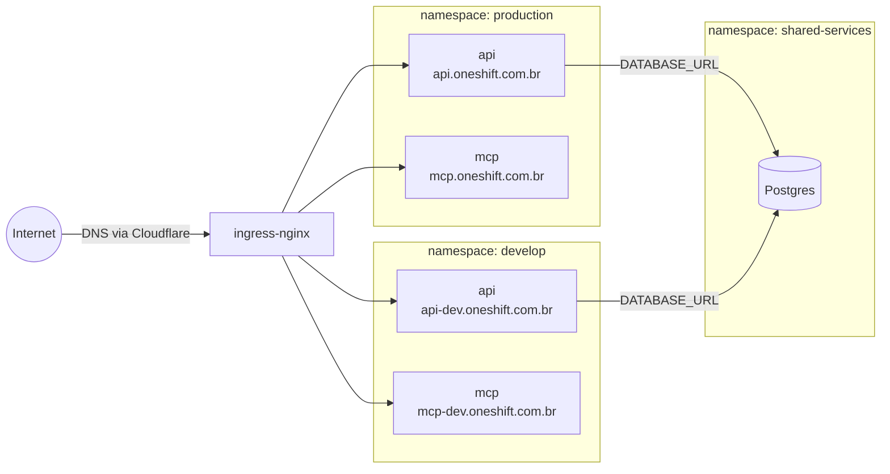

# Diagrama de infraestrutura

Visão de alto nível de como o tráfego chega até a API e o MCP no cluster
`oke-oneshift-prd`, e como os dois ambientes (`production` e `develop`)
compartilham o mesmo Postgres.

## Notas

- production e develop: api e mcp cada, develop com database própria
  (`ost_dev`) na mesma instância de Postgres.
- `ingress-nginx` e o Postgres rodam em `shared-services`, compartilhados
  pelos dois ambientes.
- O diagrama não distingue database dentro da instância de Postgres — tanto
  `production` (`ost`) quanto `develop` (`ost_dev`) apontam para o mesmo nó.
- Todos os deployments são reconciliados pelo FluxCD a partir de
  `fluxcd/production/`, `fluxcd/develop/` e `fluxcd/shared-services/` neste
  repositório.
